# SURVIVORS ARENA（サバイバーズ・アリーナ）

最大4人で協力プレイできる、見下ろし型のサバイバー系アクションゲームです。
ブラウザだけで動き、ビルド作業もサーバーも不要なので、GitHub Pages にそのまま公開できます。
**すべてのファイルが同じ場所（フォルダなし）** に入っているので、スマホからでもまとめてアップロードできます。

<p align="center">
  
  
  
  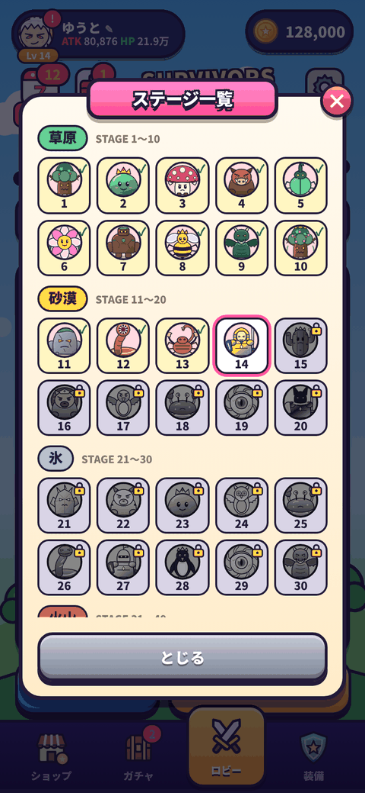
</p>
<p align="center">
  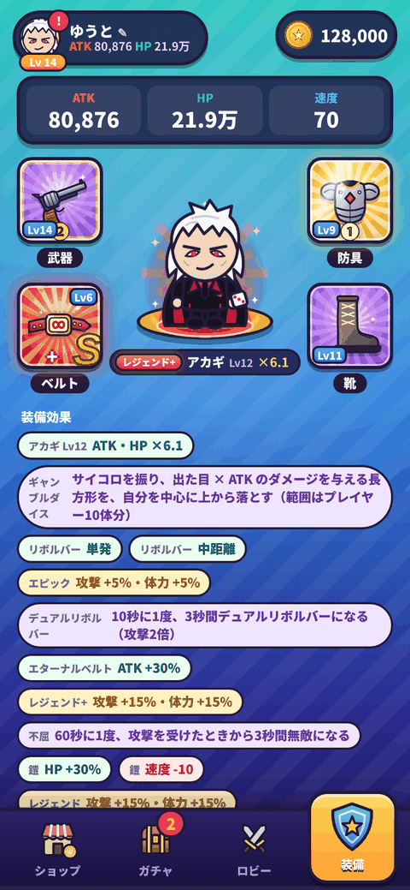
  
  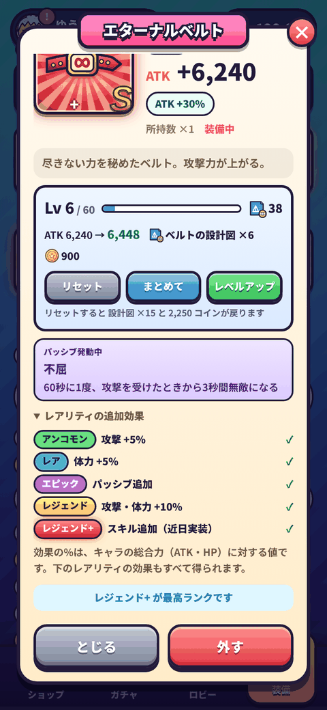
  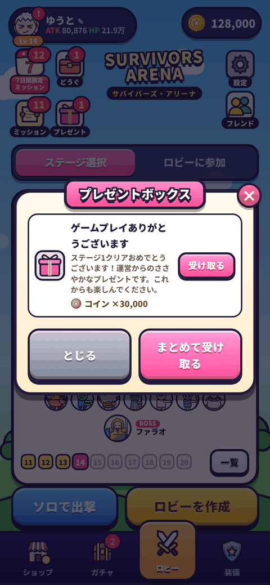
</p>
<p align="center">
  
  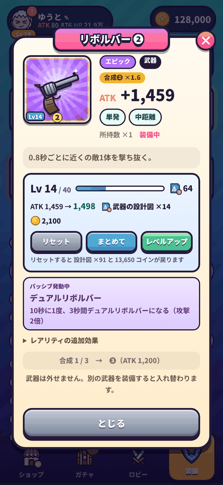
  
  
</p>
<p align="center">
  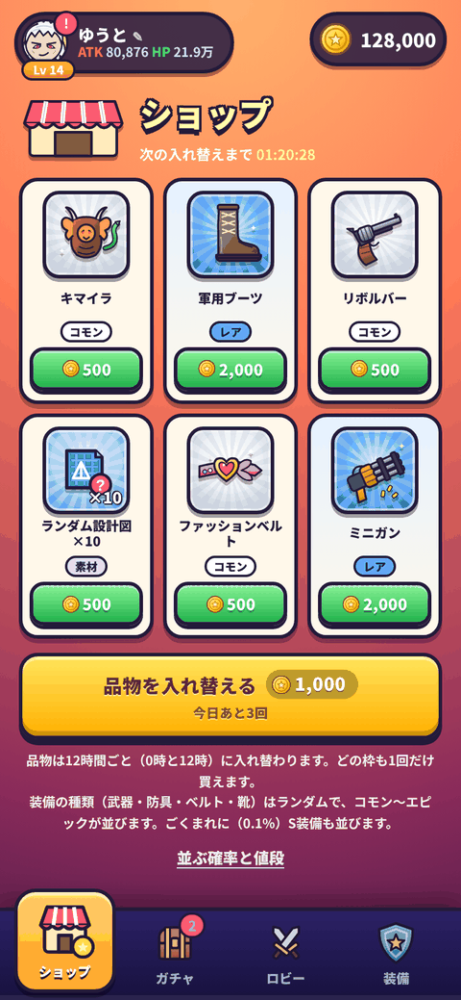
  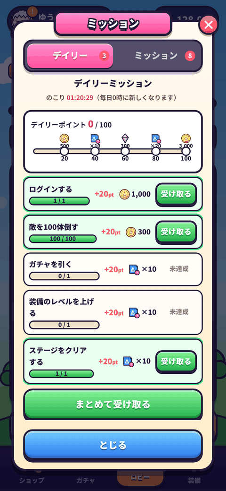
  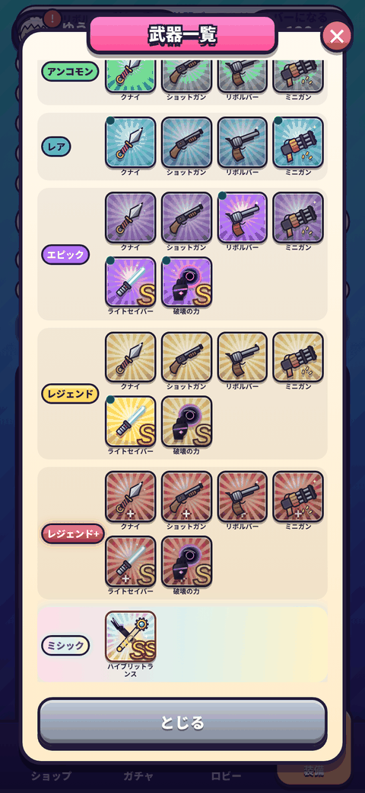
  
</p>
<p align="center">
  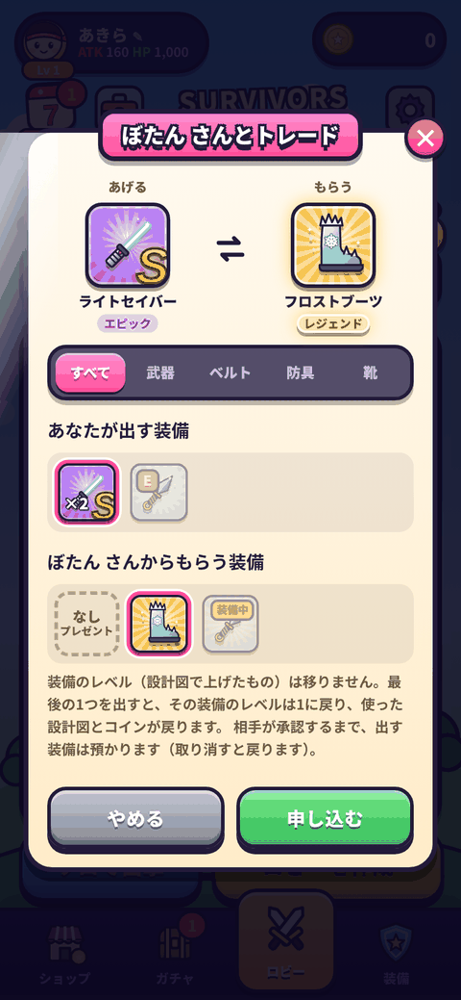
  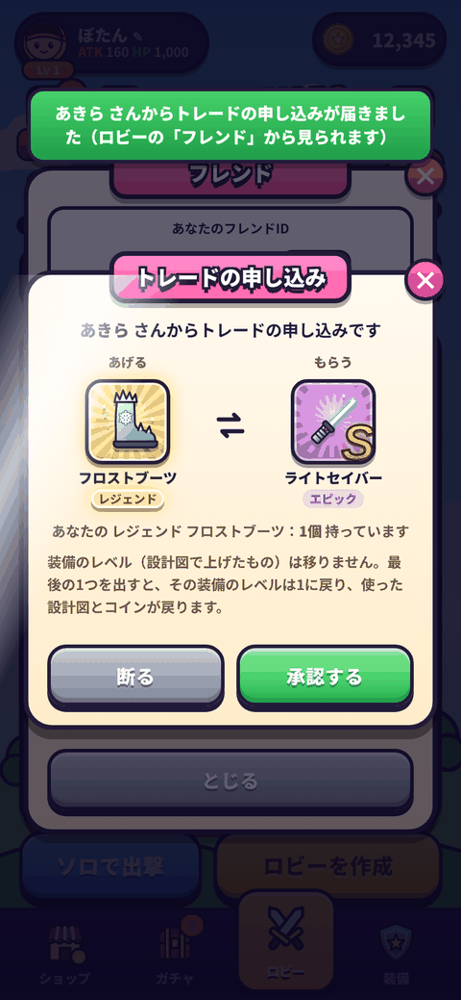
  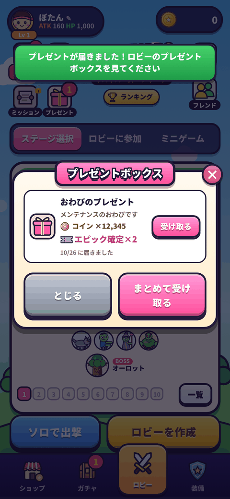
  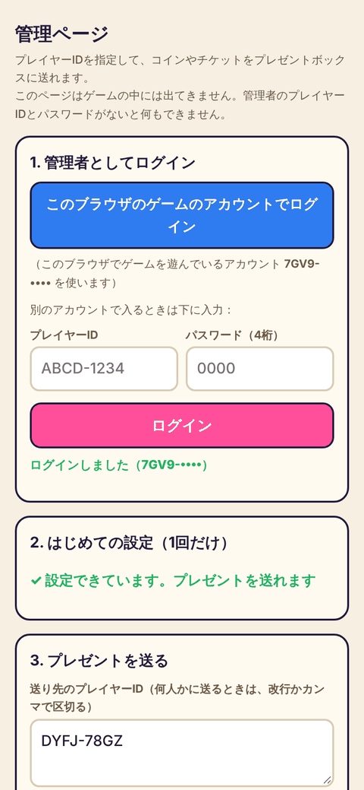
</p>
<p align="center">
  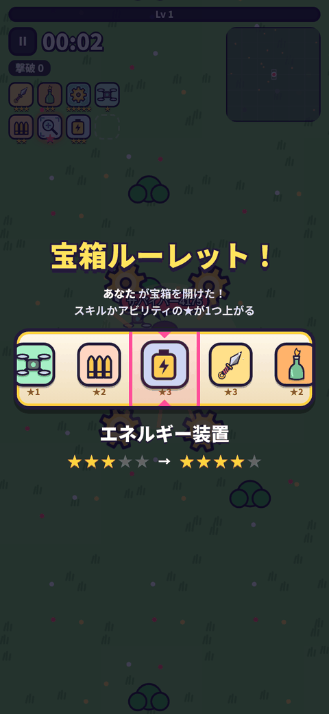
  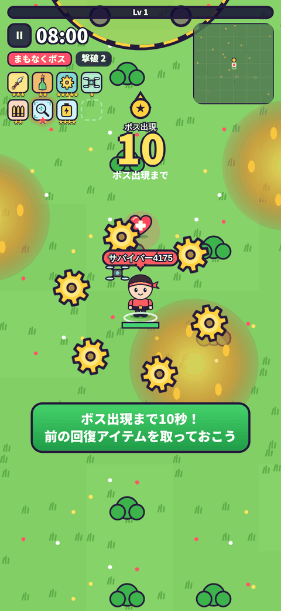
  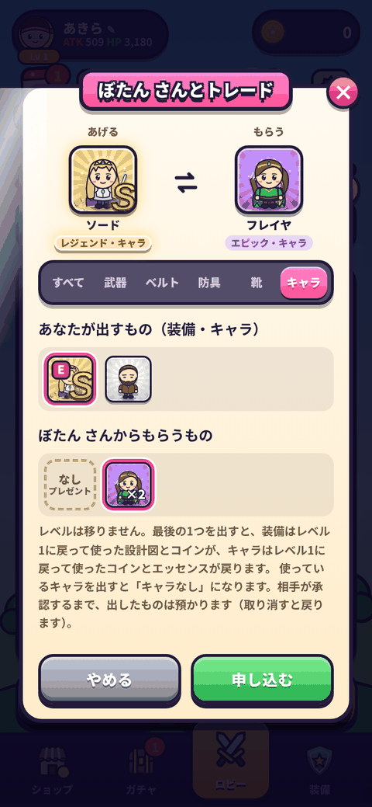
  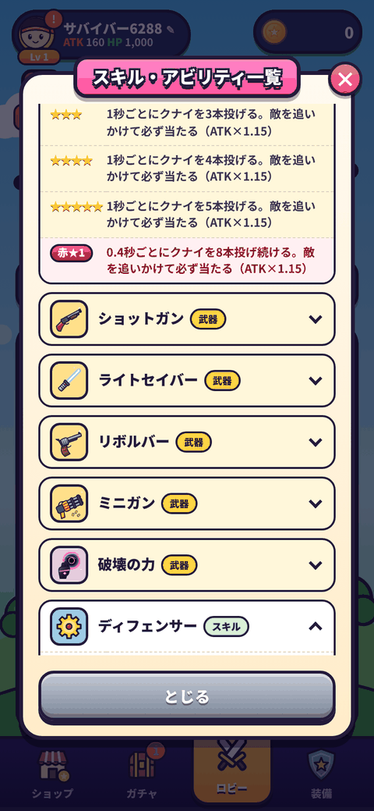
</p>

## 遊び方

### はじめの流れ
1. はじめて開くと引き継ぎコードを発行し、プレゼントとして **装備ガチャ10連無料チケット** を1枚もらえます（最初のコインは 0）
   - 引き継ぎコードを発行した日から **7日間限定ミッション** が始まります（ロビー左上の「7」）
2. チケットで装備ガチャを引き、結果画面の **「おすすめ装備」** で一番強い組み合わせを装備してステージ1へ
   - リセマラ防止のため、**ステージ1をクリアするまでは コモン・アンコモン・レア だけ** が出ます（65% / 20% / 15%）
3. **ステージ1クリア**：装備ガチャでエピックも出るようになり、ロビー左上に **プレゼントボックス** が出現（運営から 30,000 コイン）
4. **ステージ2クリア**：キャラガチャが解放され、**キャラガチャ10連無料チケット** を1枚もらえます
5. ステージをクリアするたびに **クリア報酬**（コイン・設計図・装備）がもらえます。ミッションのコインでガチャを引き、
   装備を合成・レベルアップして先のステージへ（ステージ50はやり込んで2ヶ月くらいが目安）

### ステージ（全50ステージ）

| ステージ | エリア | 中ボス | 追加で出てくる雑魚 |
| --- | --- | --- | --- |
| 1〜10 | 草原 | でかいゾンビ | スライム（3〜）・鎧スケルトン（8〜） |
| 11〜20 | 砂漠 | ミイラ巨人 | 炎狼・サソリ・ミイラ（14〜）。魔法使いゾンビの弾が赤 |
| 21〜30 | 氷 | ビッグスノーマン（雪玉を投げる） | 氷狼・雪だるま・氷コウモリ（24〜）。魔法使いゾンビの弾が水色 |
| 31〜40 | 火山 | エリートゾンビ（でかいゾンビの2倍の強さ） | 地獄の猟犬・火の玉（ぶつかると爆発）・マグマスライム（34〜） |
| 41〜50 | 廃墟 | デュラハン（突進してくる） | ゴースト（すり抜ける）・コウモリ（44〜） |

- ステージは **前のステージをクリアすると順番に解放** されます。ステージ選択の「一覧」から50ステージをまとめて見られます
- **ボスはステージごとにすべて違います（50体）**。動かないボス・歩いて追ってくるボス・突進するボス・瞬間移動するボス・ボス戦の場所のまわりを回るボスがいます
- ボスの攻撃：狙い撃ち / 全方向 / うずまき / 回る歯車 / 足元の衝撃（赤い円）/ 降ってくる攻撃（オレンジの円）/ 手下を呼ぶ。**赤い円や線が出たら、そこから逃げましょう**
- ステージ選択に **目安の ATK・HP** が出ます（緑：足りている / 黄：もう少し / 赤：足りない）。装備が足りないと雑魚敵でも1発で倒せません
- パーティーでは、**ホストが解放したステージなら、まだクリアしていない人も参加できます**

<p align="center"></p>

### アカウントレベル
- ステージをクリアするたびに経験値がもらえ、左上のアイコンの下に **レベル（最大99）** が表示されます
- 先のステージほど経験値が多く（ステージ1は75、ステージ50は1,300）、レベルが上がるほど次のレベルまでの経験値が増えます
- ステージ1〜50を1回ずつクリアすると、だいたい **Lv 40** です

### ステージクリア報酬
ステージをクリアするたびに、次の4つがもらえます（結果画面に表示されます）。

| ステージ | コイン | ランダム設計図 | エッセンス | ランダム装備 | 出る装備のレアリティ |
| --- | --- | --- | --- | --- | --- |
| 1〜10 | 倒した敵の数 × 1 | 10枚 | 300前後 | 1個 | コモン80% / アンコモン20% |
| 11〜20 | 〃 | 15枚 | 500前後 | 1個 | コモン55% / アンコモン35% / レア10% |
| 21〜30 | 〃 | 20枚 | 1,000前後 | 2個 | コモン35% / アンコモン40% / レア22% / エピック3% |
| 31〜40 | 〃 | 25枚 | 1,500前後 | 2個 | アンコモン45% / レア45% / エピック10% |
| 41〜50 | 〃 | 30枚 | 2,000前後 | 3個 | アンコモン30% / レア52% / エピック18% |

- **ランダム設計図** は、1枚ずつ 武器・防具・ベルト・靴 のどれかの設計図になります
- レジェンドとS装備はドロップしません
- エッセンスは ±20% くらいばらつきます

### ショップ（下のバーの左端）
- コインで装備・設計図・エッセンスが買えます。**3つ × 2列の6枠**で、**12時間ごと（0時と12時）** に品物が入れ替わります
- 1,000 コインで今すぐ入れ替えられます（**1日3回まで**）。どの枠も1回だけ買えます

| 品物 | 並ぶ確率 | 値段 |
| --- | --- | --- |
| コモン装備 | 29.9% | 500 |
| アンコモン装備 | 20% | 1,000 |
| レア装備 | 15% | 2,000 |
| エピック装備 | 5% | 10,000 |
| **S装備（エピック）** | **0.1%** | **15,000** |
| ランダム設計図 ×10 | 20% | 500 |
| エッセンス ×300 | 10% | 1,000 |

- 装備の種類（武器・防具・ベルト・靴）はランダムです

### ミッション（ステージ1クリアで解放）
ロビー左上の「ミッション」は、**デイリー** と **ミッション** の2つのタブがあります。

**デイリーミッション**（毎日0時に新しくなります）

| ミッション | デイリーポイント | 報酬 |
| --- | --- | --- |
| ログインする | 20 | 1,000 コイン |
| 敵を100体倒す | 20 | 300 コイン |
| ガチャを引く | 20 | ランダム設計図 10枚 |
| 装備のレベルを上げる | 20 | ランダム設計図 10枚 |
| ステージをクリアする | 20 | ランダム設計図 10枚 |

デイリーポイントのごほうび：20 → 500コイン / 40 → ランダム設計図10枚 / 60 → エッセンス300 / 80 → ランダム設計図20枚 / **100 → 3,000コイン**

**ミッション**
- ステージを1回クリアするたびに 3,000 コイン、敵を100体倒すごとに 200 コイン
- 1回だけのミッションと、何度でももらえるミッション

| ミッション | 報酬 |
| --- | --- |
| 引き継ぎコードを発行する | 30,000 コイン |
| 初めて装備のレベルを上げる | 装備ガチャ10連チケット |
| 装備のレベルを10上げるごとに（何度でも） | ランダム設計図 10枚 |
| 初めて装備を合成する | 装備ガチャ10連チケット |
| 装備を10回合成するごとに（何度でも） | ランダム設計図 10枚 |
| 初めて全身装備（武器・防具・ベルト・靴）をつける | 装備ガチャ10連チケット |
| 初めてエピック装備を手に入れる | エピックS装備選択BOX |
| 初めてレジェンド装備を手に入れる | エピックS装備選択BOX ×3 |
| 初めてキャラを手に入れる | キャラガチャ10連チケット |
| キャラを10体手に入れるごとに（何度でも） | 300 コイン |
| 初めてレジェンドキャラを手に入れる | 30,000 コイン |
| 初めてレジェンド+キャラを手に入れる | 30,000 コイン・ランダム設計図 300枚 |

- ミッションの内容とごほうびは `config.js` の `ACHIEVEMENTS` と `DAILY` で変えられます

#### v11で増えたミッション
| ミッション | 報酬 |
| --- | --- |
| ステージ5をクリア | 5,000コイン・設計図10 |
| ステージ10をクリア | エピック装備選択BOX |
| ステージ20をクリア | 30,000コイン・エッセンス1,000 |
| ステージ30をクリア | エピック装備選択BOX ×2 |
| **ステージ40をクリア（むずかしい）** | **エピックS装備選択BOX**（S装備が選べるのはこの1つだけ） |
| ステージ50をクリア | 100,000コイン・エッセンス5,000 |
| アカウントレベル10 / 20 / 30 | 10,000コイン / エピック装備選択BOX / 50,000コイン・エッセンス3,000 |
| ガチャを合計50回 / 200回引く | 装備ガチャ10連チケット / エピック装備選択BOX |
| キャラのレベルを10回上げる（何度でも） | エッセンス1,000 |
| ショップで10回買い物（何度でも） | 設計図20 |
| ミニゲームを初めて遊ぶ / 10回遊ぶ（何度でも） | 3,000コイン / 設計図10 |
| ミニゲームで初めて勝つ / 10回勝つ / 30回勝つ | 装備ガチャ10連チケット / エピック装備選択BOX / 50,000コイン・キャラガチャ10連チケット |

### 7日間限定ミッション
- **引き継ぎコードを発行した日から7日間23時間59分59秒** だけ遊べる特別なミッションです（ロビー左上、アイコンの下の「7」）
- 1日目〜7日目のミッションがあり、**ログインした日数に応じて1日分ずつ解放** されます（2日目のミッションは2日目のログインで解放）。毎日ログインしよう
- 1つクリアするごとに **300コイン** か **ランダム設計図10枚**。さらに、クリアした数に応じてごほうびがもらえます

| クリア数 | ごほうび |
| --- | --- |
| **3** | **S装備確定チケット**（v15） |
| 6 | ランダム設計図 20枚 |
| 10 | 装備ガチャ10連チケット |
| 15 | ランダム設計図 40枚 |
| **20** | **エピックS装備選択BOX**（エピックのS装備から好きなものを1つ） |
| 25 | キャラガチャ10連チケット |
| 28（全部） | 50,000 コイン |

| 日 | ミッション（敵・ガチャなどはミッションが始まってからの合計） |
| --- | --- |
| 1日目 | 1日ログイン / ステージ1クリア / 敵3,000体 / ガチャ20回 |
| 2日目 | 2日ログイン / ステージ3クリア / 敵6,000体 / ガチャ30回 |
| 3日目 | 3日ログイン / ステージ5クリア / 敵9,000体 / 装備を3回合成 |
| 4日目 | 4日ログイン / ステージ7クリア / 敵12,000体 / 装備を5回レベルアップ |
| 5日目 | 5日ログイン / ステージ9クリア / 敵15,000体 / キャラガチャ10回 |
| 6日目 | 6日ログイン / ステージ11クリア / 敵18,000体 / ガチャ50回 |
| 7日目 | 7日ログイン / ステージ13クリア / 敵21,000体 / ステージを20回クリア |

- この機能が入る前に引き継ぎコードを発行していた人は、アップデート後に初めて開いた日からスタートします
- ミッションの内容とごほうびは `config.js` の `LIMITED` で変えられます

### どうぐ
- ロビー左上の **「どうぐ」** で、選択BOX・設計図・エッセンス・チケットの数を確認できます
- **エピック装備選択BOX** は、S装備ではない16種類のエピック装備から1つ、**エピックS装備選択BOX** は、8種類のエピックS装備から1つ選べます（「開ける」を押して選ぶ）

### プレゼントボックス（運営からのプレゼント）
- ステージ1をクリアすると、ロビー左上にプレゼントボックスが出ます。最初は「ゲームプレイありがとうございます」で **30,000 コイン**
- プレゼントは `config.js` の `PRESENTS` に書き足すと増やせます（`id` はプレゼントごとに別の名前、`after` は何ステージクリアで受け取れるか）
- **特定のプレイヤーにだけ送る**ときは、管理ページ（`admin.html`）を使います（v14。下の「プレゼントを配る（管理ページ）」）

### ロビー
- **ステージ選択**：「ソロで出撃」または「ロビーを作成」
- **ロビーに参加**：ホストに教えてもらった **ロビーID（6桁）** と **パスワード** で参加（最大4人）
- **ミニゲーム**：フレンドと2〜4人で対戦するミニゲームのロビーを作る（下の「ミニゲーム」）
- 待機室ではホストだけがステージを選べます（「一覧」ボタンでも選べます）。全員が「準備OK」になると出撃できます
- 左上の名前をタップすると **ユーザーネームの変更**・**アイコンの変更**（キャラの顔から選べます）・**引き継ぎコードの確認**・**アカウント削除** ができます
  - アカウント削除：クラウドのデータと引き継ぎコード、この端末のデータがすべて消えて最初からになります（元に戻せません）
- **ミッション**：ステージ1をクリアすると解放（上の「ミッション」を見てください）
- **フレンド**（右上）：フレンドIDで申請し合うとフレンドになれます。ロビーの待機室の **「フレンドを呼ぶ」** で招待すると、相手の画面に招待が出て、そのまま参加できます（下の「フレンド」）
- **パーティーでクリアしたとき**：自分がそのステージまで進んでいる人だけが「クリア」になります
  - 例1：だれもステージ1をクリアしていない4人で、ホストがステージ1のロビーを作ってクリア → **全員** がステージ1クリア
  - 例2：ホストだけステージ4まで進んでいて、ほかの3人はステージ2まで → ステージ4をクリアしても **ホストだけ** がクリア（ほかの3人は4も2もクリアにならない）
  - 進んでいない人も参加はできます。待機室とリザルトに「クリアは記録されません」と出ます
- **難易度**：1人討伐は1倍、パーティー討伐（2人以上）は **3倍**（狼・コウモリ以外の雑魚敵と中ボスの体力が3倍。ボスは下の「ボスの強さ」）

### 設定
- **BGM の ON / OFF**、BGM・効果音の音量（音はすべてプログラムで鳴らしているので、音声ファイルはありません）
  - iPhone で音が鳴らなかった不具合を直しました（画面をタップして指を離したときに音の準備をするように。マナーモードでも鳴ります）
- ジョイスティック：「触った場所」に出るか「固定」か、大きさ、固定のときの位置
- スキルボタンの大きさと位置（設定画面のミニ画面でボタンをドラッグ）
- ミニマップの大きさ、ダメージを受けたとき画面のふちを赤く光らせるか
- **軽量化モード の ON / OFF**（v16。v17で、キャラガチャの絵やキャラ選択のレジェンドの輝きなど、残っていた動く飾りも止まるようにしました）：ONにすると、バトル画面（ミニゲームも）を少し粗く（画面の細かさ1倍）・1秒30コマで描き、ずっと動き続ける飾りのアニメーション（装備カードの回る光・キラキラ・ふわふわ動くイラストなど）と、重い影・ぼかしを止めます。スマホが熱くなる・カクカクする・電池の減りが早いときにおすすめ。ゲームの中身（強さ・敵の数など）は変わりません
- 設定はこの端末だけに保存されます（引き継ぎコードでは移りません）。バトル中もメニューから開けます

### 装備とガチャ
- 装備ガチャは 1回 3,000 / 10回 30,000 コイン。確率は **コモン60% / アンコモン23% / レア10% / エピック5% / S装備2%**（提供割合の表では S装備はエピックのすぐ下）
  （ステージ1をクリアするまではコモン・アンコモン・レアだけ。**レジェンドとレジェンド+ はガチャからは出ず、合成でだけ作れます**）
- 装備画面の **「武器一覧」** で、すべての装備をすべての色で見られます（武器・防具・ベルト・靴のタブ。タップで説明）。いちばん下には新しいレアリティ **ミシック** の「ハイブリットランス」（現在不明）が載っています
- 武器とベルトで ATK、防具と靴で HP が上がります。持っている装備だけ装着できます
- 装備画面の **「おすすめ装備」** を押すと、持っている装備から一番強くなる組み合わせに付け替えます

| レアリティ | ATK（武器・ベルト） | HP（防具・靴） | 追加効果（下のレアリティの効果もすべて持つ） |
| --- | --- | --- | --- |
| コモン（白） | 60 | 300 | なし |
| アンコモン（緑） | 130 | 650 | 攻撃 +5% |
| レア（青） | 280 | 1,400 | 体力 +5% |
| エピック（紫） | 600 | 3,000 | **パッシブ追加** |
| レジェンド（金） | 1,300 | 6,500 | 攻撃・体力 +10% |
| レジェンド+（赤・オーラ） | 4,000 | 20,000 | スキル追加（近日実装） |
| ミシック（虹色・SS） | ？ | ？ | 現在不明（今は武器一覧で見られるだけ） |

- 各レアリティの素の強さは「1つ下のレアリティの❸（2倍）」より強くなるようにしてあります（コモン❸ = 120 → アンコモン 130）
- HP はもともと高い（基礎1000）ので、防具・靴の HP は ATK の5倍にしてあります

### ガチャの天井（v11）
- **装備ガチャ**：エピックは **20回**、S装備は **50回** 引くまでに必ず1回出ます
- **キャラガチャ**：エピック以上は **40回**、レジェンド以上は **222回** 引くまでに必ず1回出ます
- 出た時点で数え直しです（例：10回目でエピックが出たら、次のエピック確定はそこからまた20回）。S装備もエピックなので、S装備が出るとエピックの数も数え直し。レジェンド以上のキャラが出ると、エピックの数も数え直し
- ガチャ画面に「確定まであと〇回」が出ます。天井で出たものには「確定！」の印がつきます
- 装備ガチャはステージ1をクリアするまで（エピックが出ない間）は数えません
- 回数は `config.js` の `GACHA_PITY` で変えられます

### 確定ガチャ（v12）
装備ガチャの下に **エピック確定ガチャ** と **S装備確定ガチャ** があります。限定チケット1枚で1回引けます（コインでは引けません）。
- **エピック確定チケット**：エピック装備が必ず出る。**10%の確率でS装備（エピック）** になります（v14。S装備の確定枠はありません）
- **S装備確定チケット**：S装備（エピック）が必ず出る

v15で、チケットをもらえるミッションが増えました（**エピック確定は全部で10枚・S装備確定は全部で3枚**。ほかに7日間限定ミッションの「3つクリア」でS装備確定を1枚）。

| ミッション | 報酬 | むずかしさ |
| --- | --- | --- |
| ステージ3をクリア | エピック確定チケット | かんたん |
| 装備のレベルを合計5回上げる | エピック確定チケット | かんたん |
| ガチャを合計30回引く | エピック確定チケット | かんたん |
| ステージ15をクリア | エピック確定チケット | ふつう |
| ステージ25をクリア | エピック確定チケット ×2 | ふつう |
| アカウントレベル25になる | エピック確定チケット | ふつう |
| ミニゲームで20回勝つ | エピック確定チケット | ふつう |
| ガチャを合計500回引く | エピック確定チケット ×2 | ふつう |
| ステージ35をクリア | **S装備確定チケット** | むずかしい |
| アカウントレベル40になる | **S装備確定チケット** | むずかしい |
| ガチャを合計1000回引く | **S装備確定チケット** | むずかしい |
- 持っている枚数は、ガチャ画面とロビー左上の「どうぐ」で見られます。確定ガチャで出たものは天井の回数に入りません
- 設定は `config.js` の `SPECIAL_GACHA`

### S装備
- **Sが付くと1.3倍強くなります**（エピックとエピックのSでは、エピックのSが1.3倍強い。レジェンドとレジェンドのSでは、レジェンドのSが1.3倍強い）
- S装備（右下に大きな金色の S）は **8種類**：ライトセイバー・破壊の力（武器）、エターナルバトルスーツ・破壊者コート（防具）、ステラベルト・エターナルベルト（ベルト）、エターナルブーツ・破壊者フットアーマー（靴）
- S装備は **エピックからしか存在しません**。合成でレジェンド・レジェンド+になっても S のままです（SS にはなりません）
- 手に入れ方：装備ガチャ（2%）・ショップ（0.1%、15,000コイン）・**エピックS装備選択BOX**
- **エピック装備選択BOX** では S装備は選べません。S装備を選べるのは **エピックS装備選択BOX** です（7日間限定ミッションの20個達成・ミッション「初めてエピック装備を手に入れる」「初めてレジェンド装備を手に入れる（×3）」でもらえます）
- 前のバージョンで持っていたコモン〜レアの S装備は、ショップの値段 × 個数分のコインに交換されます（使った設計図とコインも戻ります）
- 追加効果の%は **キャラの総合力（ATK・HP）に対する%** です。例：レジェンドの装備なら アンコモン〜レジェンドの効果をすべて得て、攻撃+15%・体力+15%・パッシブ
- 装備の補正（下の表の「ATK+30%」など）も総合力に対する%です。速度は数字そのまま（基本100）

| 種類 | 装備 | 補正 | パッシブ（エピック以上で発動） |
| --- | --- | --- | --- |
| 武器 | **破壊の力（S）** | 範囲・持続 | 5秒に1回、近くの敵にブラックホールを撃つ（3秒・毎秒ATK×1.5・敵を吸い寄せる）。パッシブ：20秒に1度、2倍の大きさのブラックホールを4秒間 |
| 武器 | ミニガン | 連射 | 10秒間撃ち続けて3秒リロード（1秒に20発・1発ATK×0.5）。パッシブ：10秒に1度、3秒間 連射速度1.5倍 |
| 武器 | クナイ | 遠距離・単発連射 | 5秒に1度、クナイを5個拡散して投げる |
| 武器 | ショットガン | 近距離・拡散 | 10秒に1度、全方向に弾を撃つ（拡散が広い） |
| 武器 | ライトセイバー（S） | **近くの敵に自動で狙いをつけて** 90度の範囲を斬る | 15秒に1度、全方向に大きく回転斬り |
| 武器 | リボルバー | 0.8秒ごとに1体を撃ち抜く | 10秒に1度、3秒間デュアルリボルバー（攻撃2倍） |
| 防具 | 鎧 | HP +30%・速度 -10 | 60秒に1度、どんな攻撃でも1発防ぐシールド（張っている間は体が **青白く光る**） |
| 防具 | レザーアーマー | HP +15% | ダメージを受けるたびに3%軽減 |
| 防具 | キマイラ | HP -30%・速度 +10 | 敵に与えたダメージの1%ぶんHPを回復 |
| 防具 | ジャケット | HP +10%・速度 +10 | モンスターを200体倒すたびにHPを5%回復 |
| 防具 | エターナルバトルスーツ（S） | 速度 +10・HP +10% | 1度だけ倒れても復活（復活時3秒無敵） |
| 防具 | 破壊者コート（S） | HP -30%・ATK +30% | HPが少ないほど攻撃力アップ（最大3倍） |
| ベルト | ステラベルト（S） | 周囲の敵の攻撃速度 -10 | 45秒に1度、隕石を落とす |
| ベルト | ウエストセンサー | HP +15%・速度 +10 | HPが50%以下のとき、受けるダメージ -20% |
| ベルト | レザーベルト | ATK +10%・HP +10% | 回復アイテムを拾うと10秒間 攻撃力 +20% |
| ベルト | エターナルベルト（S） | ATK +30% | 60秒に1度、攻撃を受けたときから3秒間無敵 |
| ベルト | 破壊者ベルト | HP -30%・ATK +30% | 受けるダメージ +10% の代わりに攻撃力 +10% |
| ベルト | ファッションベルト | 速度 -20・受けるダメージ +10% | どこにいても味方と自分のHPを毎秒0.25%回復 |
| 靴 | エターナルブーツ（S） | 速度 +10 | 毎秒HPを **1%** 回復 |
| 靴 | クローン義足 | 速度 -10・ATK +10% | 移動している間、3秒ごとにHPを1%回復 |
| 靴 | ハイブーツ | 速度 -10・ATK +15% | 敵の攻撃を10%の確率で無効にする |
| 靴 | フロストブーツ | 速度 -15・周囲の敵の速度 -5 | 10秒に1度、一番近い敵を凍らせる（中ボス・ボス以外） |
| 靴 | 破壊者フットアーマー（S） | ATK +30%・HP -30% | ダウン中の味方が多いほどダメージアップ（最大4倍） |
| 靴 | 軍用ブーツ | HP +50%・速度 -20 | 経験値 +10% |

### 合成・グレードアップ・レジェンド+

合成は **まったく同じ装備（種類・色・合成段階が同じもの）どうし** でだけできます。

| できること | 必要なもの | 結果 |
| --- | --- | --- |
| 合成 | 同じ装備3つ | ❶（1.3倍）→ ❷（1.6倍）→ ❸（2倍）。❸は稲妻が走る |
| グレードアップ | 同じ色の❸を3つ | 次のレアリティ（素）になる（例：コモン❸×3 → アンコモン） |
| レジェンド+ | レジェンド❸を5つ | 赤いオーラをまとったレジェンド+ |

- レジェンドはガチャからは出ないので、**エピック❸を3つ**（同じエピック装備が27個分）合成して作ります。とても大変なので、長く遊んで目指す目標です

- レベルを上げた装備が合成でなくなると、そのレベルは自動でリセットされ、設計図とコインが戻ります

### 装備のレベルアップ（設計図）
- 装備画面で装備をタップすると、**設計図とコインでレベルアップ** できます。レベル1上がるごとに、その装備の ATK・HP が **素の値の4%** ずつ上がります
- 設計図は **武器・防具・ベルト・靴** の4種類で、その種類の装備にだけ使えます（ステージクリア報酬や7日間限定ミッションの「ランダム設計図」から手に入ります）
- **いつでもリセットでき、使った設計図とコインが全部戻ってきます**。いい装備が手に入ったら、リセットして付け替えよう
- 同じ装備（種類・色・合成段階が同じ）はレベルを共有します

| レベル | 必要なもの | レベルの上限 |
| --- | --- | --- |
| Lv1 → 2 | 設計図1枚・150コイン | コモン 10 / アンコモン 20 / レア 30 |
| Lv2 → 3 | 設計図2枚・300コイン | エピック 40 / レジェンド 50 / レジェンド+ 60 |
| Lv n → n+1 | 設計図 n 枚・150×n コイン | |

### 引き継ぎコード
- はじめて開いたときに **プレイヤーID（8文字）と4桁のパスワード** を発行します
- 「保存しないとデータが消える可能性があります」と表示し、保存したことにチェックするまで先に進めません
- データは自動でクラウドに保存されます。機種変更などのときは「別の端末のデータを引き継ぐ」から ID とパスワードを入力
- 使うには Firebase の設定が必要です（下の「引き継ぎ（Firebase）の設定」）。未設定のときはテストモードになり、同じブラウザの中でしか引き継げません


### バトル
- 上から見下ろした視点で自分のキャラを操作します。**画面をドラッグ**（PCは **WASD / 矢印キー**）で移動
- 武器は自動で攻撃します（クナイは追尾して必中。ライトセイバーは向いている方向を斬るので、敵のほうへ動くと当たります）
- 右上に **ミニマップ**。仲間には名前のピンが付き、画面外の仲間は画面の端に矢印で表示されます
- **終盤になるほど敵が大量に湧きます**（8分ごろには序盤の何倍も）。そのかわり雑魚は終盤ほど体力が少なくなり、**7分すぎにはほとんどワンパン** で倒せます（体力の倍率は0分1倍 → 5分0.75倍 → 7分0.5倍 → 8分0.45倍。`gameConfig.js` の `ENEMY_HP_CURVE`）

| 時間 | できごと |
| --- | --- |
| 0:00〜 | 敵がどんどん増えていく（終盤ほど一気に増える） |
| 2:30 / 5:30 | **ラッシュ**：中ボスの30秒前に敵の群れが一気に突撃 |
| 3:00 / 6:00 | 中ボスが出現（エリアごとに違う） |
| 5:00〜 | **大群**：雑魚がどんどん増え、6:30ごろには画面を埋めつくすほど湧きます。目安の強さなら雑魚はほぼ一撃で倒せて気持ちよく倒せますが、ATK・HPが目安より1割ほど足りないと押しつぶされます（v14） |
| 8:00 | **雑魚と中ボスがすべて消えます**。画面に「ワープまで 5」のカウントダウン |
| 8:00 ＋5秒 | **ボス戦の場所へワープ**。パーティーなら **全員が横一列** に並びます。すぐ前に **HP30%回復のアイテム**（1人なら1つ・パーティーなら人数分。だれが取ってもOK）。開けていない宝箱もここへ移動 |
| ワープ ＋10秒 | **ボスが出現**（前に見える魔法陣のところ）。v15 |
| ボスを倒す | ステージクリア |
| 全員がダウン | ゲームオーバー |

- **ダンボール**：最初にマップに14個、その後1分ごとに4個増えます。壊すと 1/8 の確率で回復アイテム（最大HPの30%回復）
  - **1/10 の確率で爆弾** が出て、近くの敵に飛んでいって爆発します（壊した人の ATK×6、まわりの敵にまとめて当たる。近くのダンボールも連鎖でこわれる）
- **中ボスの宝箱**：中ボスを倒すと宝箱が落ちます。拾うと **ゲームの時間が止まり、ルーレット（約5秒）** が回って、今持っているスキル・アビリティのどれか1つの★が1つ上がります（v15）。パーティーなら **1つの宝箱で全員がそれぞれルーレット**（全部赤★1の人はHP30%回復）。画面の外にあるときは矢印、ミニマップには金色の四角で出ます
- **ダウンと復活**：HPが0になるとその場に墓が立ちます。別のプレイヤーが3秒そばに留まると復活（HP50%）
- **特殊スキル**：レア以上のキャラは右下の丸いボタンで特殊スキルを使えます（PCはスペースキー）
- **経験値はパーティー全員で共有**。レベルが上がると全員がそれぞれ3つの候補から1つ選び、全員が選び終わるまで時間が止まります
- スキル・アビリティはその試合限り。試合が終わればリセットされます

- **ボス**：v13で少し強化。動かなかったボスもゆっくり近づいてくる・動くボスは1.3倍速く動く・攻撃の間隔が0.8倍（よく撃つ）・体力2.5倍（スキルの進化で強くなったぶん。目安の装備で1人15〜25秒くらい）。`gameConfig.js` の `BOSS_BUFF`

### スキル（4枠：武器 + 3つ）

ロビーのロゴの下の **「スキル一覧」**（v17）で、すべてのスキルとアビリティの **★1〜赤★1 の強化内容** が見られます。

v14で、1試合で持てるスキルとアビリティが **4つずつ** になりました（前は3つずつ）。そのぶん、レベルが上がりにくくなっています（終盤は特に）。

武器は最初から★1。取得するたびに★が上がります。**★5の次は「赤★1」（進化）** で、赤★1が最大です。装備している武器以外の武器スキルは出ません。
v13で **すべてのスキルのダメージを +15%** しました（下の表は新しい値）。
攻撃する武器・スキル・パッシブは、すべて **近くの敵に自動で狙いをつけます**（全方向に撃つものと、アカギのサイコロ＝自分を中心に落とす、は除く）。

| スキル | 効果 | ★が上がると |
| --- | --- | --- |
| クナイ | 1秒ごとにクナイを投げる。追尾して必中（ATK×1.15） | クナイが1本ずつ増える |
| ショットガン | 1.5秒ごとに **近くの敵に向けて** 散弾（v15で狙いを狭くしました）。全弾命中でATK×2.3 | ダメージ×1.1、間隔-0.2秒 |
| ライトセイバー | 1秒ごとに **近くの敵を自動で狙って** 90度くらいを斬る（ATK×1.15）。届くところに敵がいないときは振らずに待つ | ダメージ×1.2、間隔-0.1秒、**攻撃範囲+15%** |
| リボルバー | **0.8秒ごと** に近くの敵1体を撃ち抜く（ATK×1.15） | ダメージ×1.2（間隔は0.8秒のまま） |
| ミニガン | 10秒間、1秒に20発ずつ近くの敵を撃ち続け、3秒リロード（1発ATK×0.58） | リロードが0.5秒ずつ短くなる |
| 破壊の力 | 5秒ごとに近くの敵へブラックホール。3秒間、敵を吸い寄せて毎秒ATK×1.75（プレイヤー2人分の大きさ） | 大きさ +0.5人分・持続 +0.5秒 |
| ディフェンサー | 自分の周りを黄色い歯車が回る（ATK×1.15）。★1で2つ。v14で回る速さを少し上げました | 歯車が1つずつ増える |
| ドローン | 近くの敵を狙って毎秒3.5発（1発ATK×0.23、**命中率50%**） | 毎秒+1.5発 |
| 雷発生機 | 近い敵に雷を落とし（ATK×1.15）、5秒間電気が残る（電気は毎秒ATK×0.7、プレイヤー3人分の円） | 雷が1本ずつ増える |
| サッカーボール | 近い敵に向かって飛び、画面の端で跳ね返るたびに近い敵を狙い直す（ATK×3.0、プレイヤー1人分より少し小さい） | 少し大きく・速くなる（★5でプレイヤー1.7人分くらい。前の3分の1） |
| 火炎瓶 | 近い敵に2本投げて炎を残す（毎秒ATK×0.7、プレイヤー2人分） | 範囲+1人分、ダメージ+0.23。**★2・★4・赤★1で投げる本数が1本ずつ増える**（★2で3本・★4で4本・赤★1で5本） |
| 重力発生機 | 周りの敵の移動速度を半分にし、毎秒ATK×0.23 | 遅くする量+10%、ダメージ+0.23 |
| **ロケット**（v17） | 3秒ごとに近くの敵へロケットを1発。当たると爆発して、まわりの敵にATK×2.0（爆発の大きさ3人分） | ダメージ+0.4・爆発が大きくなる。**★3と★5で1発ずつ増える**（★5で3発・ATK×3.6・5.4人分） |
| **楽器**（v17） | その場に音楽の広場を作る（10秒ごとに置き直す・範囲8.5人分）。ダメージはなし。**広場の中の味方全員**（パーティーなら仲間も）にバフ。重ならない（いちばん強いものだけ） | ★ごとに広場が広くなる。バフ：★1 攻撃+10% / ★2 攻撃+12% / ★3 攻撃+14%・被ダメ-14% / ★4 攻撃+16%・被ダメ-16% / ★5 攻撃+18%・被ダメ-18%・毎秒HP1%回復 |

#### 進化（赤★1）
★5のスキルは、レベルアップ（と中ボスの宝箱）で **赤★1** に進化できます。進化すると **いつも発動して大幅パワーアップ** します。

| スキル | 赤★1（進化） |
| --- | --- |
| クナイ | 0.4秒ごとに8本投げ続ける |
| ショットガン | 0.35秒ごとに11発の広い散弾 |
| ライトセイバー | 0.4秒ごとに **全方向の回転斬り**（範囲さらに1.25倍） |
| リボルバー | 0.25秒ごとに撃ち抜く |
| ミニガン | リロードなしで1秒に30発 |
| 破壊の力 | 2秒ごとに大きなブラックホール（6秒間） |
| ディフェンサー | 歯車8つが速く回り、当たる間隔が半分 |
| ドローン | 発射数1.5倍・必ず当たる |
| 雷発生機 | 0.7秒ごとに6本 |
| サッカーボール | ボールが2つになり、速く跳ね回る |
| 火炎瓶 | 1.2秒ごとに5本投げる |
| 重力発生機 | 範囲1.6倍・ダメージ2倍 |
| ロケット | 1.2秒ごとに5発・爆発がさらに1.3倍（ATK×4.0） |
| 楽器 | 広場がさらに1.2倍。攻撃+20%・被ダメ-20%・毎秒HP1.2%回復・攻撃速度+10% |

数値は `gameConfig.js` の `EVOLVE` で変えられます。

### アビリティ（4枠）

| アビリティ | ★1 | ★が上がるごとに |
| --- | --- | --- |
| エナジードリンク | 毎秒HP 1%回復（v18） | +1%（赤★1で6%） |
| 弾薬 | 攻撃力 +10% | +10% |
| エネルギー装置 | 攻撃速度 +10% | +10% |
| 防弾チョッキ | 受けるダメージ -10% | -10% |
| 巻物 | チーム全体の経験値 +10% | +10% |
| コイン獲得 | 試合後にコイン +300 | +300 |
| **拡大モジュール**（v13） | 攻撃の当たり判定 +10%（弾・斬撃の範囲・歯車・ボール・炎・電気・ブラックホール・重力・メテオなど） | +10%（赤★1で+60%） |
| **ガス注入**（v17） | 弾の速さ +10%（クナイ・散弾・ミニガン・ロケット・火炎瓶など。届く距離は同じ） | +10%（赤★1で+60%） |

アビリティも **★5の次は赤★1**（もう1段階。弾薬なら攻撃力+60%）。赤★1が最大です。
枠が埋まると、レベルアップの候補には持っているスキル・アビリティだけが出ます。赤★1になったものは出ません。
（全部がMAXになったときは「HPを回復」が出ます）

### キャラ（キャラガチャ）

キャラガチャはステージ2をクリアすると解放されます。1回3,000・10回30,000コイン。
**出る確率**は **コモン65% / アンコモン20% / レア12% / エピック2.5% / レジェンド0.45% / レジェンド+0.05%** で、
×1.2 などは出る確率ではなく、**そのキャラを使ったときの ATK・HP の増え方** です。

「装備」画面のキャラをタップすると、**見た目** と **スキル・強さ** を別々に選べます。
- **見た目**：持っていないキャラも含めて、いつでも好きなキャラに変えられます（ステージをクリアしていなくてもOK）
- **スキル・強さ**：手に入れたキャラから選びます。ATK・HP の倍率と特殊スキルはこちらで決まります
- 例：見た目はフレイヤ、スキルはソード
- レアリティが高いキャラほど、足元に光（レアは青、エピックは紫、レジェンドは金色の光線、レジェンド+は赤い炎）が出て強そうに見えます

| レアリティ | ATK・HP | キャラ | 特殊スキル |
| --- | --- | --- | --- |
| コモン | ×1.2 | スモーク / ジャスパー / アイコ（黒ひげのおじさん）/ パティー（ぱさぱさの赤髪） | なし |
| アンコモン | ×1.5 | ジョンソン / ジェイ / シード（14歳くらいの金髪の男の子）/ シャーロット（海外のお嬢様） | なし |
| レア | ×1.8 | ウィドウ | 30秒ごと：10秒間すべての敵の移動速度 -10 |
| レア | ×1.8 | キティース（服を着た二足歩行の猫） | 常時：回復ドローンが自分のまわりを飛び、半径キャラ10体分の味方か自分の中で一番HPが少ない人に毎秒1発、最大HPの1%を回復 |
| レア | ×1.8 | ダック | 30秒ごと：5秒間自分の移動速度 **+100%** |
| エピック | ×2.2 | ラージ | 30秒ごと：3秒間無敵 |
| エピック | ×2.2 | フレイヤ | 60秒ごと：自分から一定範囲内の敵全員に矢を放つ（範囲はプレイヤー10体分、ATK×3） |
| レジェンド | ×3 | ソード（S） | 常時：ライトセイバーの攻撃範囲1.5倍 |
| レジェンド | ×3 | ガンマン（S） | 30秒ごと：8秒間武器の攻撃速度2倍 |
| **レジェンド+** | **×5** | アカギ（S・白髪で黒と赤のスーツのイケおじ） | 30秒ごと：**ギャンブルダイス**。サイコロを振り、出た目 × ATK のダメージを与える長方形を、自分を中心に上から落とす（横はプレイヤー10体分） |

キティースの「一番HPが少ない人」は、最大HPに対する残りHPの割合で選びます。

アカギのサイコロの出る確率：1 → 35% / 2 → 25% / 3 → 20% / 4 → 15% / 5 → 4.5% / 6 → 0.5%

ソード・ガンマン・アカギのカードには金色の S が付いています。

#### キャラのレベル（エッセンス）
- 「装備」画面のキャラ →「スキル・強さ」で、持っているキャラを **コインとエッセンス** でレベルアップできます（最大 **Lv99**）
- 1レベルごとに、そのキャラの ATK・HP の倍率が **+2%**（例：ガンマン ×3 → Lv11 で ×3.6、Lv99 で ×8.88）
- Lv n → n+1 に コイン 1,000×n・エッセンス 300×n（Lv1→2 は 1,000コイン・300エッセンス、Lv2→3 は 2,000・600）
- エッセンスは ステージクリア・ショップ・デイリーミッション・**キャラの分解** で手に入ります

#### キャラの分解
- 被ったキャラはエッセンスに分解できます（そのキャラは1体残ります）。「被りをまとめて分解」で全部まとめてもできます

| レアリティ | 1体あたりのエッセンス |
| --- | --- |
| コモン | 30 |
| アンコモン | 100 |
| レア | 300 |
| エピック | 1,000 |
| レジェンド | 3,000 |
| レジェンド+ | 10,000 |


### ボスの強さ
- ボスは「ステージに見合う装備（目安のATK・HP）で、**1人で約30秒、パーティーで約50秒**」を目安にしています
- パーティーではボスの体力が **1人のときの体力 × 1.5 × 人数**（2人で3倍、4人で6倍）になります
- エリアの最後（10・20・30・40・50）のボスは少し体力が多めです

## ミニゲーム（v10）
<p align="center">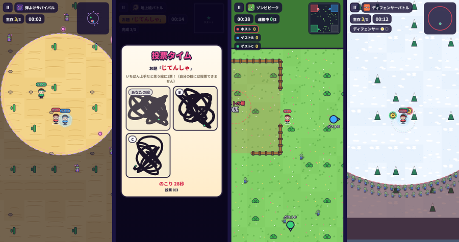</p>

ロビーの3つめのタブ **「ミニゲーム」** から、ゲームを選んで **ロビーを作成** します。参加する人は「ロビーに参加」タブでロビーIDとパスワードを入れるか、待機室の **「フレンドを呼ぶ」** の招待から入れます。**2人以上** そろうとホストがスタートできます（最大4人）。ゲームと制限時間は待機室の中でもホストが変えられます。

| ゲーム | 遊び方 | 勝ち |
| --- | --- | --- |
| **弾よけサバイバル** | 円のまわりの魔法使いゾンビが全方向から魔法の弾を撃ってくる。1発でも当たったら脱落して観戦（‹ › で見る人を変えられる）。最初は5体、6秒ごとに1体ずつ増える | 最後まで生き残った人 |
| **地上絵バトル** | 真っ暗な中、歩いた道が黒い線になる（消せない・一筆書き）。お題はランダム。ミニマップにはスタート地点だけ出る。描き終わったら「完成！」。全員が完成（か時間切れ）すると絵が並び、自分以外の絵に1票 | 票がいちばん多い人。制限時間は 60 / 120 / 180秒 |
| **ゾンビピーク** | 広いマップの4すみに柵（自分の色）。歩き回るゾンビに重なると捕まえる（一度に3匹まで）。自分の柵の真ん中に行くとゾンビが柵に入り、柵の中でばらばらに歩く。他の人の柵からゾンビを取ることもできる。ゾンビは攻撃してこない | 終了時に柵の中のゾンビがいちばん多い人。制限時間は 180 / 300秒 |
| **ディフェンサーバトル** | 自分のまわりを2枚のディフェンサーが回る。相手のディフェンサーに当たったら1発で脱落。ディフェンサーはこわれない（ディフェンサーどうしはすり抜ける）。12秒たつとゾンビの輪がせまってきて、さわると脱落 | 最後まで生き残った人 |

- 武器・スキル・パッシブの **攻撃はすべて使えません**。有利になるのは次のものだけです
  - **移動速度**（装備の速度。ミニゲームでは 60〜150% の間）
  - 弾よけ・ディフェンサー：**ガードシールド**（鎧：60秒に1度、1発防ぐ）・**見切り**（ハイブーツ：10%で当たらない）・**不屈**（エターナルベルト：60秒に1度、当たっても3秒無敵）・**不死の加護**（エターナルバトルスーツ：1度だけ復活）・**アイアンボディ**（ラージ：3秒無敵）・**ダッシュ**（ダック）
  - 地上絵：**ダッシュ**（ダック） / ゾンビピーク：**ダッシュ**（ダック）・**ブラックヴェール**（ウィドウ：10秒間ゾンビが遅くなる）
  - パッシブはバトルと同じく **エピック以上の装備** で働きます。待機室の枠と、ゲームの最初の説明に「有効な効果」が出ます
- 弾やディフェンサーに当たったかどうかは **自分の画面で判定** します（通信が遅れても、よけたのに当たった…となりにくい）
- ミニゲームではコインや経験値は増えません（遊ぶだけのモードです）
- 調整は `mgsim.js` の先頭の `T`（弾の数・速さ、マップの広さ、輪がせまる速さなど）と、`config.js` の `MINIGAMES`（ゲームの説明・制限時間・お題）でできます

## 戦績とランキング（v11）
- **戦績**：左上の名前 →「戦績を見る」。クリアしたステージ・ミニゲームの試合数と勝った数（ゲームごとも）・今の武器 / 防具 / ベルト / 靴・使っているキャラとキャラのレベル・アカウントレベル・総合力が見られます
- **フレンドの戦績**：「フレンド」の一覧でフレンドをタップ
- **ランキング**：ロビーのロゴの下の「ランキング」（または左上の名前 →「ランキング」）。**総合力（ATK×6＋HP）** の順位で、「全体（上位100人）」と「フレンド」の2つがあります。名前をタップするとその人の戦績が見られます
- 戦績とランキングは、**引き継ぎコードを発行している人** の分がクラウドにのります（ゲームを開いている間、1分ごとと、装備などが変わったときに更新）
- ランキングを見るには、下の **手順4のルールを v11 のものに貼り替えて** ください
- v14から総合力は **ATK×6＋HP**（HPはだいたいATKの6倍なので、ATKとHPを同じ重さで見ています）。倍率は `config.js` の `RANKING.atkWeight`

## フレンド
- ロビー右上の **「フレンド」** を開くと、自分の **フレンドID（9桁の数字）** が出ます。フレンドIDを教えあって申請し、相手が承認するとフレンドです（最大50人）
- 引き継ぎの **プレイヤーIDとパスワードは人に教えない** でください（フレンドIDは引き継ぎとは関係ないので、教えて大丈夫です）
- ロビーの待機室の **「フレンドを呼ぶ」** で招待すると、相手がゲームを開いていれば招待が届き、「参加する」でそのまま同じロビーに入れます（招待は10分間有効）
- フレンド一覧では、最近ゲームを開いている人に「オンライン」と出ます
- フレンド機能は **Firebase を設定して、引き継ぎコードを発行している人** だけ使えます。v8 からは Firebase の **ルールが新しくなった** ので、下の手順4のルールに貼り替えてください

## フレンドと装備・キャラをトレード（v14・キャラはv15）
- 「フレンド」の一覧で、フレンドの **「トレード」** を押します
- **あなたが出すもの** と **相手からもらうもの** を選んで「申し込む」（もらう方を「なし」にすると、プレゼントとしてあげられます）。相手の持ち物も見られます
- **キャラもトレードできます**（上のタブの「キャラ」）。装備とキャラの交換もOK。使っているキャラを出すと「キャラなし」になります
- キャラのレベルも移りません。**最後の1体を出すと、そのキャラのレベルは1に戻り、使ったコインとエッセンスが戻ります**
- 申し込むと、出す装備は **相手が答えるまで預かり**（持ち物から1つ減ります）。「フレンド」の「トレード」欄の「取り消す」で戻せます
- 相手の画面に申し込みが届きます（「フレンド」のボタンに数字が出ます）。「見る」→ **承認** すると交換、**断る** と預けた装備が戻ります
- 1人のフレンドに申し込めるのは1つまで。相手がゲームを開いていなくても、次に開いたときに届きます
- 装備のレベル（設計図で上げたもの）は相手に移りません。**最後の1つを出すと、その装備のレベルは1に戻り、使った設計図とコインが戻ります**（合成と同じ）。装備中の武器の最後の1つは出せません（ほかの装備は、最後の1つを出すと外れます）
- 承認と取り消しが同時でも、Firebase のルールで片方だけが通るようにしているので、装備が増えたり消えたりしません
- ※ セーブデータは各自の端末にあるので、データを書き換えるようなズルは防げません（友だち同士で遊ぶ前提の機能です）
- 使うには、下の **手順4のルールを v14 のものに貼り替えて** ください（`tradeInv` と `trades` が増えています）

## プレゼントを配る（管理ページ・v14）
指定したプレイヤーIDの人、または **全てのプレイヤー**（v15）のプレゼントボックスに、コインやチケットを送れます。**ゲームの中には出てきません。**

1. 公開しているゲームの URL の最後を `admin.html` にして開く（例：`https://<ユーザー名>.github.io/<リポジトリ名>/admin.html`）
2. 「このブラウザのゲームのアカウントでログイン」を押す（ゲームを遊んでいるのと同じブラウザで開いたとき）。別の端末なら、**自分の** プレイヤーIDとパスワードを入れてログイン。ログインしたアカウントが管理者になります
3. はじめての1回だけ：「ルールをコピー」→ Firebase コンソールの Realtime Database → ルール に **全部消して貼り付け → 公開** → 「もう一度確認」で「✓ 設定できています」になればOK
   （コピーされるのは、手順4のルールの `ADMIN_UID` を、あなたの UID に置き換えたものです）
4. 送り先のプレイヤーID（何人でも。改行かカンマで区切る）・タイトル・メッセージ・コイン（とチケット）を入れて「送る」
   - 送れるもの：**コイン・ランダム設計図・エナジーエッセンス・装備ガチャ10連チケット・キャラガチャ10連チケット・エピック確定ガチャチケット・S確定ガチャチケット**（v17。送りたいものだけ数を入れる）
   - **送り先を空のまま送ると、全てのプレイヤーに送ります**（引き継ぎコードを発行している人。1人1回まで。あとから始めた人にも届きます）
   - 全てのプレイヤーに送るときは「受け取れる期限」（なし / 3日 / 7日 / 14日 / 30日）を選べます
5. 相手がゲームを開くと、数分以内に **プレゼントボックスに届きます**（開いたときにも確かめます）
6. 「送ったプレゼントを見る」でプレイヤーIDを入れると、受け取ったかどうかが分かり、**まだ受け取っていないものは取り消せます**
   - **空のまま「見る」** を押すと、全てのプレイヤーに送ったものと **受け取った人数** が出ます。取り消すと、まだ受け取っていない人には届かなくなります

- 管理者のプレイヤーIDとパスワードを知らない人が `admin.html` を開いても、何もできません（ルールで管理者の UID だけが書けるようにしています）
- 送れるのは1回 1億コイン・チケット999枚まで。相手のプレイヤーIDは本人に聞いてください（人に教えないものなので、送るとき以外には使わないでください）
- **ゲームを更新してルールを貼り替えるときは、管理ページの「ルールを表示」からコピーしたものを貼ってください**（README のルールをそのまま貼ると `ADMIN_UID` のままなので、管理ページが使えなくなります。その場合は「ルールを表示」から貼り直せば戻ります）

## 引き継ぎ（Firebase）の設定

引き継ぎコードでデータを別の端末に移すには、無料の [Firebase](https://console.firebase.google.com/) を使います（Spark プランで無料）。
設定は最初に1回だけです。

1. [Firebase コンソール](https://console.firebase.google.com/) で **プロジェクトを追加**（Google アナリティクスはオフで大丈夫です）
2. 左のメニュー **構築 → Authentication → 始める** を開き、ログイン方法で **メール / パスワード** を有効にする
   （プレイヤーIDとパスワードから内部用のアカウントを作るために使います。メールは送られません）
3. **構築 → Realtime Database → データベースを作成**。場所はどこでもOK（日本から遊ぶなら `asia-southeast1` がおすすめ）、**ロックモード** で開始
4. Realtime Database の **ルール** タブに下を貼り付けて **公開**（自分のデータだけ読み書きでき、フレンド機能に必要なところだけ他の人と共有する設定です）
   ```json
   {
     "rules": {
       "saves": {
         "$uid": {
           ".read": "auth != null && auth.uid === $uid",
           ".write": "auth != null && auth.uid === $uid"
         }
       },
       "friendIds": {
         "$fid": {
           ".read": "auth != null",
           ".write": "auth != null && (!data.exists() || data.child('uid').val() === auth.uid)",
           ".validate": "newData.child('uid').val() === auth.uid"
         }
       },
       "profiles": {
         ".read": "auth != null",
         ".indexOn": ["pw"],
         "$uid": {
           ".write": "auth != null && auth.uid === $uid"
         }
       },
       "friendReq": {
         "$to": {
           ".read": "auth != null && auth.uid === $to",
           ".write": "auth != null && auth.uid === $to",
           "$from": { ".write": "auth != null && auth.uid === $from" }
         }
       },
       "friends": {
         "$uid": {
           ".read": "auth != null && auth.uid === $uid",
           ".write": "auth != null && auth.uid === $uid",
           "$fid": { ".write": "auth != null && auth.uid === $fid && (!newData.exists() || root.child('friendReq').child($fid).child($uid).exists())" }
         }
       },
       "invites": {
         "$to": {
           ".read": "auth != null && auth.uid === $to",
           ".write": "auth != null && auth.uid === $to",
           "$from": { ".write": "auth != null && auth.uid === $from && root.child('friends').child($to).child($from).exists()" }
         }
       },
       "tradeInv": {
         "$uid": {
           ".read": "auth != null && (auth.uid === $uid || root.child('friends').child($uid).child(auth.uid).exists())",
           ".write": "auth != null && auth.uid === $uid"
         }
       },
       "trades": {
         "$to": {
           ".read": "auth != null && auth.uid === $to",
           "$from": {
             ".read": "auth != null && auth.uid === $from",
             ".write": "auth != null && ((auth.uid === $from && ((!data.exists() && newData.child('state').val() === 'offer' && root.child('friends').child($to).child($from).exists()) || (data.child('state').val() === 'offer' && newData.child('state').val() === 'canceled') || (data.exists() && data.child('state').val() !== 'offer' && !newData.exists()))) || (auth.uid === $to && data.child('state').val() === 'offer' && (newData.child('state').val() === 'accepted' || newData.child('state').val() === 'declined')))",
             ".validate": "!data.exists() || (newData.child('id').val() === data.child('id').val() && newData.child('give').val() === data.child('give').val() && newData.child('want').val() === data.child('want').val())"
           }
         }
       },
       "gifts": {
         "$pid": {
           ".read": "auth != null && (auth.uid === 'ADMIN_UID' || auth.token.email === $pid + '@player.survivors-arena.game')",
           "$gid": {
             ".write": "auth != null && auth.uid === 'ADMIN_UID'",
             ".validate": "newData.child('coins').isNumber() && newData.child('coins').val() >= 0",
             "claimed": {
               ".write": "auth != null && auth.token.email === $pid + '@player.survivors-arena.game' && data.parent().child('coins').exists()",
               ".validate": "newData.isNumber()"
             }
           }
         }
       },
       "giftsAll": {
         ".read": "auth != null",
         "$gid": {
           ".write": "auth != null && auth.uid === 'ADMIN_UID'",
           ".validate": "newData.child('coins').isNumber() && newData.child('coins').val() >= 0"
         }
       },
       "giftsAllGot": {
         ".read": "auth != null && auth.uid === 'ADMIN_UID'",
         ".write": "auth != null && auth.uid === 'ADMIN_UID'",
         "$gid": {
           "$uid": {
             ".write": "auth != null && auth.uid === $uid && root.child('giftsAll').child($gid).exists()",
             ".validate": "newData.isNumber()"
           }
         }
       }
     }
   }
   ```
   - **v15（全てのプレイヤーへのプレゼント）で、このルールが新しくなりました。** `giftsAll`・`giftsAllGot` が増えています（貼り替えないと、全てのプレイヤーへは送れません。1人ずつには前のルールでも送れます）
   - v14（トレード・管理ページのプレゼント）で `tradeInv`・`trades`・`gifts` が増えました。前のルールは全部消して、これに貼り替えてください（貼り替えないとトレードとプレゼントの配布が使えません。ほかの機能は前のルールでも動きます）
   - 管理ページ（`admin.html`）を使うときは、ここではなく **管理ページの「ルールをコピー」で出るもの**（`ADMIN_UID` があなたの UID になったもの）を貼ってください
   - v11（ランキング）で、このルールが新しくなりました。 `profiles` のところに、ランキング用の `".read"` と `".indexOn"` が増えています。前のルールを使っている人は、全部消してこれに貼り替えてください（貼り替えないとランキングが見られません。フレンド機能は前のルールのままでも動きます）
5. **プロジェクトの設定（歯車）→ 全般 → マイアプリ → ウェブ（`</>`）** でアプリを登録し、表示される `firebaseConfig` から
   `apiKey` と `databaseURL` を `config.js` の `CLOUD` に貼り付ける
   ```js
   CLOUD: {
     apiKey: 'AIza....',
     databaseURL: 'https://xxxx-default-rtdb.asia-southeast1.firebasedatabase.app',
     ...
   },
   ```
   ※ `apiKey` は公開しても大丈夫な値です（データは手順4のルールで守られます）

メモ
- パスワードは4桁なので、ID を知っている人が総当たりすれば当てられる可能性があります。Firebase は失敗が続くと一時的にログインを止めますが、大事なデータを守る仕組みではありません
- 同じ ID を2台で同時に使うと、あとから保存した方のデータが残ります
- 引き継ぎコードは左上の名前をタップするといつでも確認できます


## GitHub Pages で公開する

1. GitHub で新しいリポジトリを作ります（Public）
2. **Add file → Upload files** で、このフォルダの中のファイルを **すべて** アップロードします
   - フォルダは使っていないので、スマホからでもまとめて選んでアップロードできます
   - 更新するときは、同じ名前のファイルをアップロードすれば上書きされます
3. リポジトリの **Settings → Pages** を開き、Source を **Deploy from a branch**、Branch を **main** / **/(root)** にして Save
4. 1〜2分後、`https://<ユーザー名>.github.io/<リポジトリ名>/` で遊べます

## 手元で動かす

`index.html` をダブルクリックするだけでも動きます。
ローカルサーバーで開く場合は、どちらかを実行して `http://localhost:8000` を開いてください。

```bash
python3 -m http.server 8000
# または
npx serve .
```

## マルチプレイの仕組み

| モード | 内容 |
| --- | --- |
| オンライン（標準） | [PeerJS](https://peerjs.com/)（WebRTC）で端末どうしを直接つなぎます。PeerJS の無料サーバーを接続の仲介に使うので、自分でサーバーを用意する必要はありません |
| ローカル | 同じブラウザのタブどうしで通信します。URL の最後に `?net=local` を付けると使えます。タブを2つ以上開けば1台で協力プレイのテストができます |

- バトル中は **ホストの端末が敵・スキル・経験値などをすべて計算** し、1秒に12回、全員に状態を送ります。ゲストは自分の位置を1秒に20回ホストへ送ります
- **ホストがアプリを閉じたり、別のアプリに切り替えたりすると全員のゲームが止まります**。ホストは画面を開いたままにしてください
- オンライン通信が読み込めない時（オフラインなど）は、自動でローカルモードに切り替わります
- PeerJS の無料サーバーは混雑することがあります。安定させたい場合は自分の PeerServer を立てて、`config.js` の `NET.PEER_OPTIONS` に `{ host, port, path, secure }` を設定してください
- 学校や会社のネットワークなど、WebRTC が制限された環境ではつながらないことがあります

## ファイル構成（すべて同じ場所）

| ファイル | 内容 |
| --- | --- |
| `index.html` | 画面の骨組み |
| `style.css` | 見た目（カラフルなゲーム風UI） |
| `config.js` | ★ガチャ・装備・レアリティ・キャラ・ステージ・プレゼント・アカウントレベルの設定 |
| `gameConfig.js` | ★バトルの設定（目安の強さ・敵・中ボス・50体のボス・スキル・経験値・ミッション報酬） |
| `state.js` | セーブデータ（コイン・装備・合成・装備レベル・設計図・キャラ・ミッション・7日間限定ミッション・アカウントレベル・プレゼント） |
| `art.js` / `charArt.js` / `gameArt.js` | イラスト（装備・キャラ・ステージ・敵・ボス・スキルの絵。すべてSVG） |
| `ui.js` | トースト・モーダル・装備カード・大きな数の表示（〇万・〇億） |
| `sound.js` / `settings.js` | 効果音とBGM / 設定 |
| `cloud.js` / `net.js` | 引き継ぎコード（Firebase）/ ロビー通信（PeerJS） |
| `lobby.js` / `gacha.js` / `equip.js` / `mission.js` | ロビー・ガチャ・装備（武器一覧・キャラのレベル）・ミッション（デイリー・7日間限定・どうぐ）の画面 |
| `shop.js` / `friends.js` / `record.js` | ショップ / フレンド（Firebase） / 戦績とランキング |
| `trade.js` / `gifts.js` | フレンドとの装備トレード / 管理ページから届くプレゼント（v14） |
| `admin.html` | 管理ページ（プレイヤーIDを指定してプレゼントを送る。ゲームの中には出てきません） |
| `sim.js` / `render.js` / `game.js` | バトルの計算 / 描画 / 操作・HUD・通信・結果画面 |
| `mgsim.js` / `minigame.js` | ミニゲームの進行（ホスト） / ミニゲームの画面（操作・描画・投票・結果） |
| `main.js` | 起動処理・上のバー・下のバー |
| `favicon.svg` | タブのアイコン |
| `ss-*.png` | README 用の画像（ゲームには不要） |

## 調整したい時

| 変えたいもの | 場所 |
| --- | --- |
| ゲーム名・最初のコイン・ガチャの値段 | `config.js` |
| ガチャの確率（装備・キャラ） | `config.js` の `GACHA_RATES` |
| ガチャの天井（何回で確定か） | `config.js` の `GACHA_PITY` |
| ダンボールの数・爆弾（確率・ダメージ・範囲） | `gameConfig.js` の `BOXES` |
| ミッションの内容と報酬 | `config.js` の `ACHIEVEMENTS` |
| ミニゲーム（説明・制限時間・地上絵のお題） | `config.js` の `MINIGAMES` |
| ミニゲームの難しさ（弾の数・速さ、マップの広さなど） | `mgsim.js` の先頭の `T` |
| 装備のレベル（上限・上がり方・設計図とコインの数） | `config.js` の `LEVELS` |
| ステージクリア報酬（コイン・設計図・装備） | `config.js` の `STAGE_DROPS` |
| 7日間限定ミッション / どうぐ | `config.js` の `LIMITED` / `TOOLS` |
| ミッション / デイリーミッション | `config.js` の `ACHIEVEMENTS` / `DAILY`（解放するステージは `MISSION_UNLOCK`） |
| ショップ（並ぶ確率・値段・入れ替え） | `config.js` の `SHOP` |
| S装備の倍率 / ミシック装備 | `config.js` の `S_GEAR` / `MYTHIC_ITEMS`（S装備は `ITEMS` の `s: true`） |
| キャラのレベル / 分解 | `config.js` の `CHAR_LEVEL` / `DISMANTLE` |
| フレンド（人数・招待の有効時間など） | `config.js` の `FRIENDS` |
| 最初にもらえる無料チケット / 最初に出るレアリティ | `config.js` の `START_TICKETS` / `EARLY_RARITIES` |
| レアリティの強さ・追加効果 | `config.js` の `RARITIES` / `RARITY_EFFECTS` |
| 装備の補正・パッシブ | `config.js` の `ITEMS`（`bonus` と `passive`） |
| 合成・グレードアップに必要な数 | `config.js` の `FUSION` |
| ステージの名前 | `config.js` の `BIOMES` |
| 運営からのプレゼント | `config.js` の `PRESENTS`（特定の人にだけ送るときは `admin.html`） |
| ランキングの総合力（ATK を何倍して HP に足すか） | `config.js` の `RANKING` |
| エピック確定ガチャで S装備が出る確率 | `config.js` の `SPECIAL_GACHA` の `sRate` |
| 終盤（5分〜）の大群 | `gameConfig.js` の `FLOOD`（`from`：始まる分 / `full`：いちばん多くなる分 / `count`：数） |
| 8分からボス戦まで（ワープまでの秒・ボス出現までの秒・回復アイテム） | `gameConfig.js` の `BOSS_INTRO` |
| 中ボスの宝箱のルーレットの長さ | `gameConfig.js` の `CHEST.roulette` |
| アカウントレベルの上がり方 | `config.js` の `ACCOUNT` |
| ステージごとの目安の強さ（敵の強さもこれで決まる） | `gameConfig.js` の `STAGE_TARGET` / `STAGE_DANGER` / `BIOME_SCALE` / `UNIT` |
| 敵・中ボス・エリアごとの出現 | `gameConfig.js` の `ENEMIES` / `BIOME_ENEMIES` |
| ボス（50体）の動き・攻撃・体力 | `gameConfig.js` の `BOSSES` / `STAGE_BOSSES` / `BOSS_BASE_HP` / `BOSS_DMG` |
| 敵の数（終盤の湧き方） | `gameConfig.js` の `SPAWN` / `MAX_ENEMIES` |
| レベルの上がりやすさ | `gameConfig.js` の `XP` |
| スキルの数値（ライトセイバー・ドローンなど） | `gameConfig.js` の `SKILL_PARAMS` |
| 難易度（1人 / パーティー） | `gameConfig.js` の `DIFFICULTY` / `BOSS_PARTY` / `PARTY` |
| ミッション報酬 | `gameConfig.js` の `MISSIONS` |

### バランスについて（自動プレイで測定した目安）

1日1時間ほど（6試合くらい）遊んで、デイリーミッション・ショップも使ったときのコイン・設計図・エッセンス・ドロップから、
ガチャ・合成・装備レベル・キャラ（レベル）の育ち方を計算し、そのステージに着く頃の「やや弱め」のプレイヤーの強さを **目安の強さ** にしています
（7日間限定ミッションの報酬は入れていないので、もらえる人は少し楽になります）。
敵の体力は目安のATKに、敵の攻撃力は目安のHPに合わせて大きくなります。

| ステージ | 目安 ATK | 目安 HP | だいたいの時期 |
| --- | --- | --- | --- |
| 1 | 330 | 2,560 | 最初の無料10連（ぎりぎりクリアできるくらい） |
| 2 | 609 | 3,840 | ここから先はプレゼントとミッションの報酬で一気に強くなる |
| 5 | 2,060 | 1.3万 | 1日目 |
| 10 | 6,540 | 3.4万 | 4日目ごろ |
| 20 | 1.2万 | 7万 | 2週間ごろ |
| 30 | 1.7万 | 10.4万 | 4週間ごろ |
| 40 | 2.2万 | 13.3万 | 6週間ごろ |
| 50 | 2.6万 | 16.8万 | 2ヶ月ごろ（エピックの合成・装備レベル・キャラのレベルが必要） |

- 目安の装備のとき、ボット（自動プレイ）の1人プレイでのクリア率はおよそ5〜8割、4人パーティーではほぼクリアできました
- 序盤の雑魚敵は目安の装備で **2発くらい**（狼とコウモリは1発）で倒れる体力です
- ガチャの運で強さが大きく変わるので、目安より強ければ先へ、足りなければ前のステージでコインを集めて装備を育てましょう
- 自動プレイで測った値なので、実際に遊んでみて `gameConfig.js` で調整してください

**テスト用のコインボタン**：`config.js` の `DEBUG_COIN_BUTTON: true` にすると、コイン横に＋ボタン（押すと 30,000 コイン増える）が出ます。公開するときは `false` のままにしてください。

セーブデータはブラウザの localStorage に保存されます。最初からやり直したい時は、プレイヤー情報の「アカウントを削除する」を使ってください。
前のバージョン（5ステージ）のデータは、自動で新しいステージ1〜5のクリアとして引き継がれます。

## 今後のアイデア

- [x] 効果音・BGM
- [x] ステージクリアで次のステージを解放
- [x] 装備の合成・グレードアップ
- [x] 装備のレベルアップ（設計図）・ステージクリア報酬
- [x] 7日間限定ミッション・どうぐ（エピック装備選択BOX・エピックS装備選択BOX）
- [x] 新しい装備8種類（破壊の力・ミニガン・キマイラ・ジャケット・ウエストセンサー・レザーベルト・クローン義足・ハイブーツ）
- [x] ショップ・デイリーミッション・ミッション・キャラのレベル・S装備・フレンド
- [ ] ミシック装備（ハイブリットランス）の入手方法
- [ ] レジェンド+ のスキル（近日実装）
- [ ] 経験値の宝石を拾う仕組み

## ライセンス

[MIT License](LICENSE)
